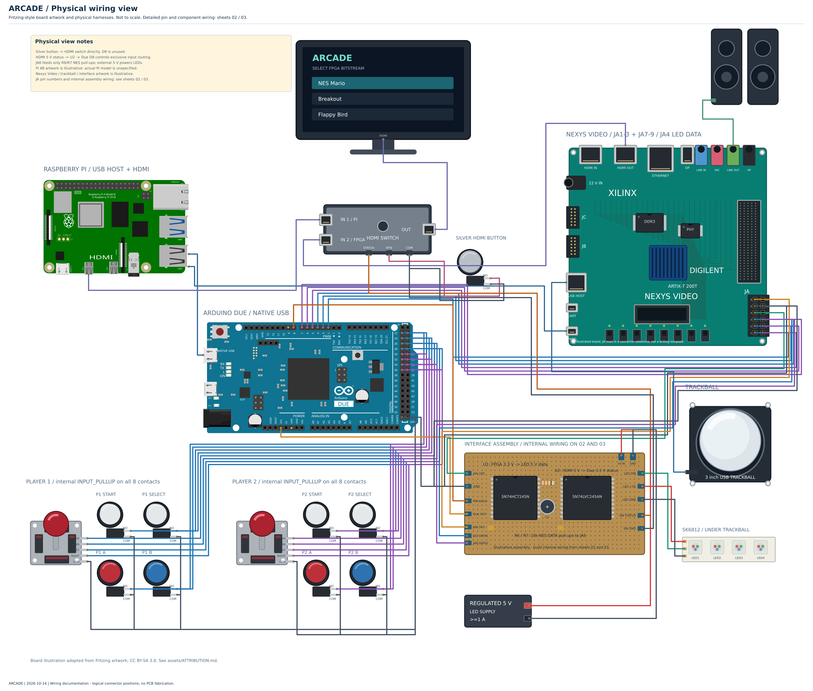

# ece383-arcade

Applied Reconfigurable Computing And Digital Electronics.

This cabinet uses a Raspberry Pi menu, a Nexys Video FPGA, and an Arduino Due that reads two sets of arcade controls. The Due sends either USB keyboard input to the Pi or two NES controller streams to the FPGA according to the HDMI switch's source-status signal.

## Cabinet wiring and physical view

The [wiring guide](design/README.md) includes the Due pin map, JA connector orientation, power rails, LED and HDMI-status level shifters, and bill of materials. The [compatibility review](design/REPOSITORY-COMPATIBILITY.md) records the differences from the existing controller code and the checks still needed on hardware.



Open the self-contained Fritzing sketches in Breadboard view:

- [Cabinet interconnect](design/01-arcade-system.fzz)
- [Controls and JA pin wiring](design/02-controls-and-ja.fzz)
- [LED and HDMI interfaces](design/03-led-and-hdmi-interfaces.fzz)
- [Physical wiring view](design/04-realistic-breadboard.fzz)

The physical view uses Fritzing Due artwork and representative Pi 4B artwork; the actual Pi model is unspecified. Other components are illustrated. The JA inset and interface assembly are not mechanical or fabrication drawings. See [artwork attribution](design/assets/ATTRIBUTION.md).

## Controller firmware variants

| Firmware | Behavior |
| --- | --- |
| [Existing controller example](controllers/due_interface.c) | Both Start buttons pulse Due D9 to switch HDMI; D8 gates Pi HID, but NES emulation stays active. |
| [Manual-switch Arduino sketch](design/reference/arcade_due_manual_switch/arcade_due_manual_switch.ino) | Silver button switches HDMI directly. D8 reads translated status and enables only Pi HID or FPGA NES output. D9 is unused. |

Use the manual-switch sketch for the wiring shown here. Its project folder can be opened with the Arduino IDE for an Arduino Due with Native USB support. The sketch is a hardware-unverified implementation draft; the legacy example is preserved.

Both use button order **A, B, Select, Start, Up, Down, Left, Right**, on D22-D29 for Player 1 and D30-D37 for Player 2. Every player switch connects to GND and uses an internal pull-up. NES latch/clock/data pins are D2/D3/D4 and D5/D6/D7. The revised wiring adds two 10 kohm data pull-ups to FPGA JA6 3.3 V for open-drain NES output.

The manual-switch sketch defaults to **D8 HIGH = Pi selected**. Measure the switch status before use; invert `PI_SELECTED_LEVEL` if necessary. It releases both destinations during status transitions. Both players can navigate the Pi with arrows, `a`, `b`, Enter and Space; they remain independent NES controllers in FPGA mode.

## Pi software and hardware checks

`server/fpgaloader.php` loads bitstreams over the Pi-to-Nexys USB JTAG cable using `openFPGALoader -b nexysVideo`. The reviewed Pi sources do not use GPIO. The HDMI button is independent of both Pi and Due outputs.

`kiosk/index.htm` is a keypress tester. The menu links in `server/test.php` still need arrow/Start navigation and kiosk startup integration for the intended menu flow. The repository contains compiled game bitstreams without their HDL/XDC sources, so their LED, trackball, audio and NES timing compatibility must be checked separately. The trackball remains connected to the FPGA even while Pi video is selected.

## Rebuild and validation

Python 3 and a C++11-capable `g++` are needed for the checks. Inkscape is only needed to render a PNG preview.

```sh
python3 tools/build_realistic.py
python3 tools/validate_design.py
python3 tools/test_due_firmware.py
inkscape design/previews/04-realistic-breadboard.svg --export-type=png --export-filename=design/previews/04-realistic-breadboard.png --export-width=2800
```

The builders regenerate all four native sketches, SVG previews, endpoint metadata and custom parts. Generated raw `.fz` files and `design/parts/` are ignored because the `.fzz` sketches embed their parts.

The validator checks archive/SVG integrity, reciprocal connector links, upstream pin compatibility, supply separation and manual-switch routing. Firmware tests run against mocked Arduino and Keyboard APIs; they do not establish SAM3X interrupt timing or compile for the actual Due board. Native Fritzing application opening/export and hardware behavior remain unverified.
